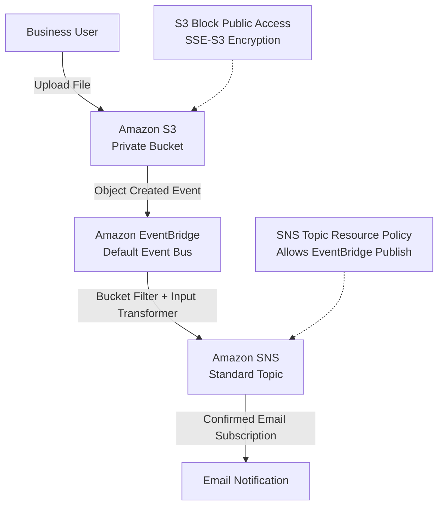

# AWS Project 3 — Architecture Diagram

## Serverless File Upload Notification System

## Architecture Overview

1. A business user uploads a file to a private Amazon S3 bucket.
2. Amazon S3 sends the object creation event to EventBridge.
3. EventBridge filters events by source, event type and bucket name.
4. The Input Transformer extracts file metadata.
5. Amazon SNS delivers the notification to a confirmed email subscriber.

**Region:** Asia Pacific (Tokyo) - ap-northeast-1

**Project Type:** Personal AWS Hands-on Learning Project
